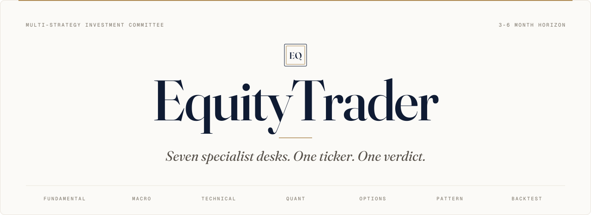
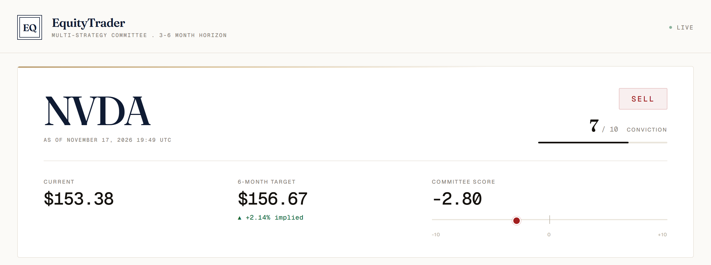
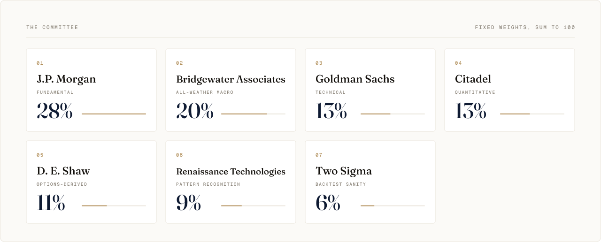
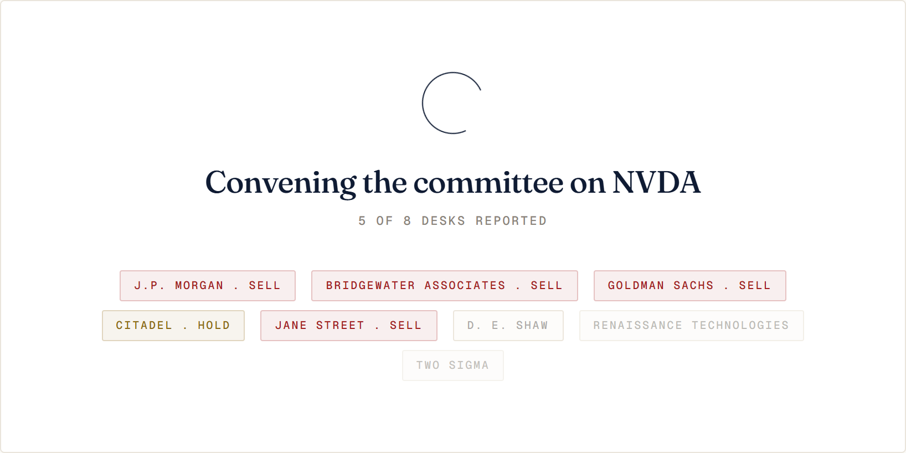
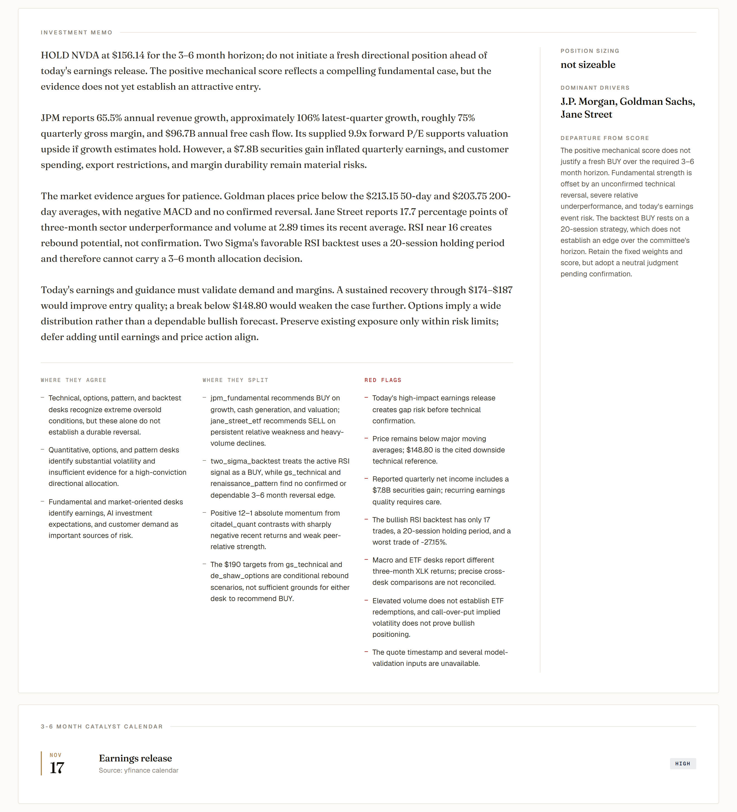
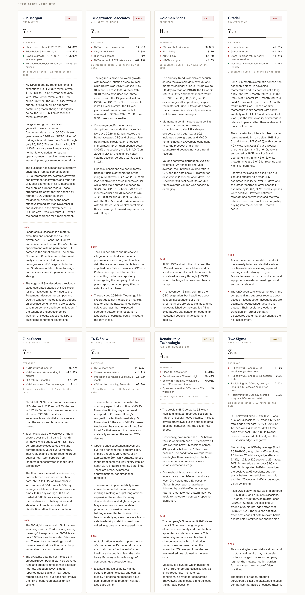
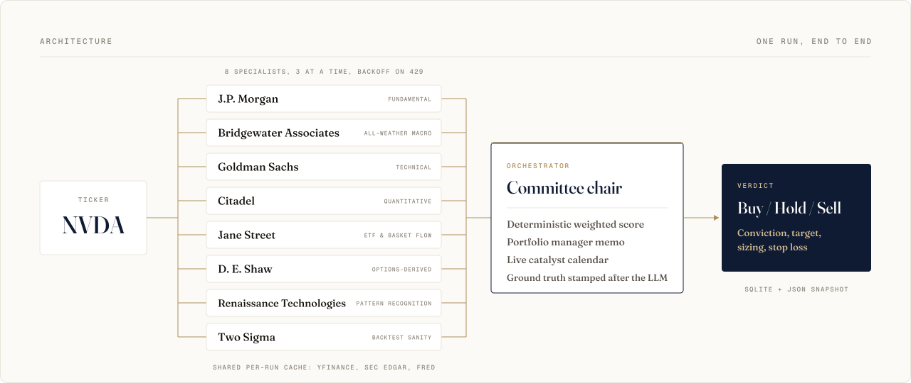

<div align="center">

<picture>
  <source media="(prefers-color-scheme: dark)" srcset="docs/assets/banner-dark.svg">
  
</picture>

<br><br>


<br><br>

**Eight specialist agents, each modeled on the desk of a storied investment house, analyze one ticker independently.**<br>
**A committee chair turns their verdicts into a single Buy, Hold or Sell for the next 3 to 6 months.**

<br>

<a href="#quick-start">Quick start</a> &nbsp;&middot;&nbsp;
<a href="#the-committee">The committee</a> &nbsp;&middot;&nbsp;
<a href="#a-run-live">A run, live</a> &nbsp;&middot;&nbsp;
<a href="#the-report">The report</a> &nbsp;&middot;&nbsp;
<a href="#architecture">Architecture</a> &nbsp;&middot;&nbsp;
<a href="#how-the-verdict-is-computed">Scoring</a>

</div>

<br>



<br>

> [!IMPORTANT]
> **Every ticker run makes paid LLM calls.** An `OPENAI_API_KEY` with funded credit is required. One run is eight `gpt-6-luna` specialist runs plus one `gpt-6.1-sol` orchestrator call, billed per token by OpenAI. Cost depends on prompt length and how many tools each agent calls. Models are set per agent in `equity_trader/config.py`, which can also route any agent to Gemini, Groq or DeepSeek.

<br>

## The committee

<picture>
  <source media="(prefers-color-scheme: dark)" srcset="docs/assets/committee-dark.svg">
  
</picture>

Each desk has its own analysis framework, its own tools and its own voice. All eight return the same structured verdict: a recommendation, a conviction from 1 to 10, an optional 6-month price target, thesis bullets, risks, and the data points cited.

<details>
<summary>The committee as a table</summary>

<br>

| Desk | Discipline | Weight |
|---|---|---:|
| J.P. Morgan | Fundamental | 25% |
| Bridgewater Associates | All-Weather Macro | 18% |
| Goldman Sachs | Technical | 12% |
| Citadel | Quantitative | 12% |
| Jane Street | ETF & Basket Flow | 10% |
| D. E. Shaw | Options-Derived | 10% |
| Renaissance Technologies | Pattern Recognition | 8% |
| Two Sigma | Backtest Sanity | 5% |

</details>

<br>

## What each desk sees

Every desk starts from the same context: today's date and price, the company's sector, next earnings date and short interest, a dashboard of about fifty macro readings with their direction, and the FRED catalogue for anything else. Then each works with tools of its own.

All of it is computed in code and handed over with dates and sample sizes, so the model interprets numbers instead of producing them.

| Desk | Its own tools |
|---|---|
| J.P. Morgan | SEC statements with ratios, the earnings release and guidance, consensus and revisions, analyst actions, insider trades, recent 8-Ks |
| Bridgewater Associates | How the stock moves with rates, credit, the dollar and oil, its record in past market stress, cross-asset and sector boards |
| Goldman Sachs | Trend on three timeframes, support and resistance, volume, relative strength, the last 120 daily bars |
| Citadel | Factor scorecard ranked against industry peers, estimate revisions, style performance, risk statistics |
| Jane Street | ETF weights and fund size, sector rotation and breadth, relative strength, index event dates, liquidity |
| D. E. Shaw | Implied volatility across expiries, skew, positioning, implied against realized, earnings pricing, index volatility |
| Renaissance Technologies | Full-history seasonality, earnings event study, what followed past shocks and days like today, gaps, volatility regime |
| Two Sigma | Eleven long and short rules at one, three and six month holds, with significance, stability and a cross-check on the market |

<br>

## A run, live

Each desk's call appears the moment it reports, so a run that takes a minute or two is never a blank spinner. The terminal report shows the same progress.



<br>

## The report

The chair writes a portfolio manager memo, names where the desks agree and where they split, flags what could break the call, and suggests a position size. The catalyst calendar is fetched live from market data, so the dates are real.



Every desk's reasoning stays on the page. Nothing is averaged away.



<br>

## Architecture

<picture>
  <source media="(prefers-color-scheme: dark)" srcset="docs/assets/architecture-dark.svg">
  
</picture>

- **Independent specialists.** Each desk is a standalone OpenAI Agents SDK agent with `AgentVerdict` as its output type. No desk sees another's work. Desks share context, never conclusions.
- **The model interprets; code computes.** Ratios, indicators, event studies and backtests are calculated in code. No desk does arithmetic or recalls a fact from memory.
- **A gatherer before the desks.** One component fetches everything the desks will read, one request stream at a time, before any desk starts. It is code, not a model: what to fetch is fixed by the desks' tool lists. The desks then read from a per-run `ContextVar` cache and make no calls to the data providers, apart from a FRED lookup a desk chooses for itself.
- **Rate-limit aware fan-out.** A semaphore runs three agents at a time, with exponential backoff on `RateLimitError`.
- **No silent gaps.** A request Yahoo refuses is retried once after a pause and then raises, so a desk sees a failed fetch as a failure and not as empty data.
- **Temporal grounding.** The orchestrator is handed today's date, the current price, and a real catalyst calendar. Any catalyst dated outside the horizon is dropped in code.
- **Events, not just numbers.** The fundamental desk reads the company's five most recent 8-Ks in full, so a CEO departure, an acquisition or a new guarantee is weighed in the call before it shows up in any statement.
- **Dated inputs, honest statistics.** Every reading carries its observation date. Every statistical claim carries its sample size and the baseline it has to beat, so a stale number or a fake edge is visible to the chair.
- **Graceful degradation.** A failed desk is excluded and its weight is redistributed. Only the runner can mark a desk as failed. If the orchestrator call fails, a mechanical aggregation takes its place.

<br>

## How the verdict is computed

The committee score is a weighted sum, computed in code:

```
score = sum( sign(recommendation) * conviction * weight ) / 100
```

`sign` is +1 for BUY, 0 for HOLD and -1 for SELL. Conviction runs 1 to 10 and weights sum to 100, so the score ranges from -10 to +10.

The weights are fixed in code. The orchestrator cannot change them. It reads the score and all eight verdicts, then writes a 150 to 300 word memo and makes the final call. That call is a judgment and may depart from the score, but a call against the score's sign has to come with a written rationale.

After the LLM call, the score, the conviction-weighted price target, the run timestamp, the current price, the agent verdicts and the sourced catalysts are stamped over whatever the model returned. The model cannot alter them. A call against the score's sign with no rationale is flagged on the report.

<br>

## Quick start

[uv](https://docs.astral.sh/uv/) is the only prerequisite. It installs Python for you.

```bash
git clone https://github.com/lenamonj/equity-trader.git
cd equity-trader
cp .env.template .env      # then fill in the three keys below
uv sync
```

```bash
uv run python run.py NVDA   # terminal report
uv run python app.py        # web UI at http://127.0.0.1:7860
uv run gradio app.py        # web UI with hot reload
```

| Key | Source | Cost |
|---|---|---|
| `OPENAI_API_KEY` | [platform.openai.com](https://platform.openai.com) | Paid, per token |
| `FRED_API_KEY` | [fred.stlouisfed.org](https://fred.stlouisfed.org/docs/api/api_key.html) | Free |
| `SEC_EDGAR_USER_AGENT_EMAIL` | Your own email | Free. The SEC requires it for EDGAR access |
| `ICE_HISTORY_FILE` | A local parquet of older ICE BofA spread observations | Optional. FRED serves three years of these series; with the file, spreads are ranked against ten |

<details>
<summary>Installing uv</summary>

<br>

macOS and Linux:

```bash
curl -LsSf https://astral.sh/uv/install.sh | sh
```

Windows (PowerShell):

```powershell
powershell -ExecutionPolicy ByPass -c "irm https://astral.sh/uv/install.ps1 | iex"
```

Other routes are in the [uv install docs](https://docs.astral.sh/uv/getting-started/installation/).

</details>

<br>

## Data sources

All market data is free. No paid feeds.

| Source | Used for |
|---|---|
| SEC EDGAR | Financial statements as filed, earnings releases and guidance, the text of recent 8-Ks |
| yfinance | Prices, valuation multiples, analyst estimates and rating actions, insider transactions, options chains, ETF holdings, earnings and dividend dates |
| FRED | About fifty macro series on rates, inflation, growth, labor, credit and liquidity, sector series, the data release calendar |

Companies that file no US-GAAP statements with the SEC, such as IFRS filers, fall back to yfinance statements, and the desk is told which source it received.

<br>

## Testing

```bash
uv run pytest -m "not slow"   # unit tests: mocked LLM, mocked data
uv run pytest -m slow         # integration: live yfinance and SEC EDGAR
uv run pytest                 # everything
```

The mocked tier covers every data tool and study on constructed inputs, all eight agents and their tool wiring, the gatherer, the orchestrator, the runner, the scoring math, persistence, the cache and the schemas.

<br>

## Project layout

<details>
<summary>Expand the tree</summary>

```
equity-trader/
├── app.py                      # Gradio UI entry point
├── run.py                      # CLI entry point
├── pyproject.toml              # uv project + dependencies
├── .env.template               # required environment variables
├── equity_trader/
│   ├── config.py               # model routing + weights
│   ├── schemas.py              # Pydantic: AgentVerdict, OrchestratorVerdict
│   ├── exceptions.py
│   ├── scoring.py              # deterministic weighted score
│   ├── orchestrator.py         # LLM synthesizer + mechanical fallback
│   ├── gatherer.py             # fetches the run's data before the desks start
│   ├── runner.py               # gatherer, then async fan-out, then the chair
│   ├── persistence.py          # SQLite + JSON snapshots
│   ├── ui.css                  # web UI stylesheet
│   ├── data/
│   │   ├── cache.py            # per-run ContextVar cache
│   │   ├── edgar_tools.py      # SEC statements, earnings releases, 8-Ks
│   │   ├── fred_tools.py       # macro dashboard, sector series, search
│   │   ├── yfinance_tools.py   # raw market data access
│   │   ├── company_tools.py    # snapshot, estimates, insiders, peers, factors
│   │   ├── technical_tools.py  # trend, levels, volume, relative strength
│   │   ├── pattern_tools.py    # seasonality, event and forward-return studies
│   │   ├── options_tools.py    # volatility surface, skew, positioning
│   │   ├── market_tools.py     # cross-asset, sectors, ETFs, stress history
│   │   └── calendar_tools.py   # real upcoming catalysts
│   └── agents/
│       ├── base.py             # agent factory, tool registry, shared rules
│       ├── shared_tools.py     # context tools every desk has
│       ├── jpm_fundamental.py
│       ├── bridgewater_macro.py
│       ├── gs_technical.py
│       ├── citadel_quant.py
│       ├── jane_street_etf.py
│       ├── de_shaw_options.py
│       ├── renaissance_pattern.py
│       └── two_sigma_backtest.py
├── tests/                      # unit + integration tests
├── .github/workflows/ci.yml    # lint + unit tests on every push
└── docs/
    ├── design.md               # system design
    ├── assets/                 # README plates + their generator
    └── screenshots/
```

</details>

The full design is in [docs/design.md](docs/design.md).

<br>

## Disclaimer

EquityTrader is a research and engineering project. Its output is generated by language models, can be wrong, and is not investment advice.

The desks are stylized personas. This project is not affiliated with, endorsed by, or representative of J.P. Morgan, Bridgewater Associates, Goldman Sachs, Citadel, Jane Street, D. E. Shaw, Renaissance Technologies or Two Sigma. Those names belong to their respective owners.

<br>

<div align="center">

Built with [Claude Code](https://claude.com/claude-code), the [OpenAI Agents SDK](https://github.com/openai/openai-agents-python) and [Gradio](https://gradio.app/).

[MIT](LICENSE). Copyright (c) 2026 Jeff Lenamon.

</div>
